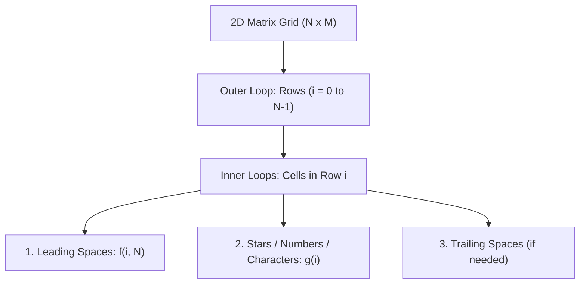

# 🧩 DSA Mastery Roadmap & Pattern Mental Models

**Tags:** #dsa #patterns #complexity #big-o #algorithms #java #mental-models

---

## 1. The Core Philosophy of Pattern Solving

Pattern printing questions are not about memorizing loops; they are **matrix coordinate geometry** problems. Every pattern question teaches you:
1. Identifying the loop invariants (How does Row `i` relate to Column `j`?).
2. Mapping discrete mathematical sequences ($2i - 1$, $2(N - i - 1)$, etc.).
3. Handling symmetry (Mirroring via midpoint splits or distance functions).



---

## 2. Taxonomy of Patterns (Patterns 1 to 22 Mastered - 100%)

All 22 patterns solved in `knowledge-vault/01-DSA/01-basics/02-patterns/` fall into 4 core mathematical families:

### Family A: Direct Monotonic Triangles (Patterns 1–6)
- **Increasing Right-Angled:** Stars count equals row index `j <= i`.
- **Inverted Right-Angled:** Stars count decreases with row: `j < N - i`.
- **Numeric Variation:** Replace `*` with `j + 1` (column-based) or `i + 1` (row-based).

### Family B: Pyramids & Diamond Symmetry (Patterns 7–10)
- **The Pyramid Invariant:**
  - Leading spaces: $N - i - 1$
  - Stars: $2i + 1$ (always odd: $1, 3, 5, 7...$)
- **The Diamond (Pattern 9):**
  - Top half: Standard pyramid ($i = 0 \dots N-1$).
  - Bottom half: Inverted pyramid with spaces $i$ and stars $2(N - i) - 1$.
- **The Half Diamond (Pattern 10):**
  - Number of stars at row $i$ for $2N-1$ rows: $\text{stars} = i \le N ? i : 2N - i$.

### Family C: Binary Alternation & Number Crowns (Patterns 11–13)
- **Alternating Bits (Pattern 11):**
  - If row starts with `1` when `i % 2 == 0`, every toggle is `val = 1 - val` or $(i + j) \% 2 == 0 \to 1 \text{ else } 0$.
- **Number Crown (Pattern 12):**
  - Symmetrical numbers with dynamic center gap:
    - Left numbers: `1` to `i`
    - Spaces: $2 \times (N - i)$
    - Right numbers: `i` down to `1`
- **Floyd's Triangle (Pattern 13):**
  - Running continuous counter `int count = 1;` across all cells.

### Family D: Character & Advanced Symmetry (Patterns 14–22)
- **Character Grids (Patterns 14–18):**
  - Mapping loop index to ASCII: `(char)('A' + j)`.
  - Palindromic letter pyramid (Pattern 17): Increment letters up to midpoint, then decrement!
- **Hollow Symmetrical Butterfly & Diamond (Patterns 19–20):**
  - Composed of two mirror symmetric halves.
  - Symmetrical butterfly: Left stars $\min(i, 2N-i)$, spaces $2(N-\text{stars})$, right stars $\min(i, 2N-i)$.
- **Hollow Rectangle (Pattern 21):**
  - Boundary stars: `i == 0 || i == n-1 || j == 0 || j == n-1`, else internal spaces.
- **Concentric Number Matrix (Pattern 22):**
  - For each cell $(i, j)$ in a $(2N - 1) \times (2N - 1)$ grid:
    $$\text{val} = N - \min(\text{top, bottom, left, right})$$

---

## 3. Step 1.3: Time & Space Complexity Master Models

Detailed documentation available in: [01-basics/03-time-complexity/README.md](./01-basics/03-time-complexity/README.md)

### The 3 Inviolable Big-O Golden Rules
```
1. ALWAYS WORST-CASE: Compute maximum possible operations for the hardest input.
2. DROP CONSTANTS:    O(3N) ──▶ O(N),  O(5N^2) ──▶ O(N^2).
3. DROP LOWER-ORDER:  O(4N^3 + 3N^2 + 8) ──▶ O(N^3).
```

### The Triangular Loop Invariant (Foundation of Nested Algorithms)
```
for (int i = 0; i < N; i++) {
    for (int j = 0; j <= i; j++) { ... }
}
Operations = 1 + 2 + 3 + ... + N = N(N + 1) / 2 = N^2/2 + N/2  ──▶  O(N^2)
```

### Space Complexity Formula & Senior Warning
$$\text{Total Space Complexity} = \text{Input Space} + \text{Auxiliary Space}$$
- **Auxiliary Space**: Extra memory allocated by the algorithm to compute the result.
- **Strict Rule**: Never mutate input data in-place to cheat $\mathcal{O}(1)$ space unless explicitly instructed; doing so corrupts caller memory and causes concurrency race conditions in production!

### The $10^8$ Operations Benchmark (Online Judges)
Modern judging platforms (LeetCode, Codeforces) execute $\approx 10^8$ operations per second.
- $N \le 10^3 \implies \mathcal{O}(N^2)$ is safe ($(10^3)^2 = 10^6 \le 10^8$).
- $N \le 10^5 \implies \mathcal{O}(N \log N)$ or $\mathcal{O}(N)$ required ($(10^5)^2 = 10^{10} \gg 10^8 \implies$ **TLE!**).
- $N \ge 10^9 \dots 10^{18} \implies \mathcal{O}(\log N)$ or $\mathcal{O}(1)$ required.

---

## 4. The Next DSA Milestones

```mermaid
flowchart TD
    P[✅ Step 1.2: Patterns 1-22 (100%)] --> TC[✅ Step 1.3: Time & Space Complexity]
    TC --> STL[🎯 Step 1.4: Java Collections / C++ STL Basics]
    STL --> M[Step 1.5: Basic Maths]
    M --> R[Step 1.6: Basic Recursion]
    R --> H[Step 1.7: Basic Hashing]
    H --> A[Step 2: Arrays & Two Pointers]
```

### Next Immediate Sprint:
1. **Step 1.4: Java Collections Framework & STL Basics**:
   - `ArrayList`, `LinkedList`, `Vector`
   - `Stack`, `Queue`, `Deque`, `ArrayDeque`
   - `PriorityQueue` (Min-Heap / Max-Heap)
   - `HashSet`, `LinkedHashSet`, `TreeSet`
   - `HashMap`, `LinkedHashMap`, `TreeMap`
   - Time complexities of each collection method (e.g., `add()`, `get()`, `contains()`).
