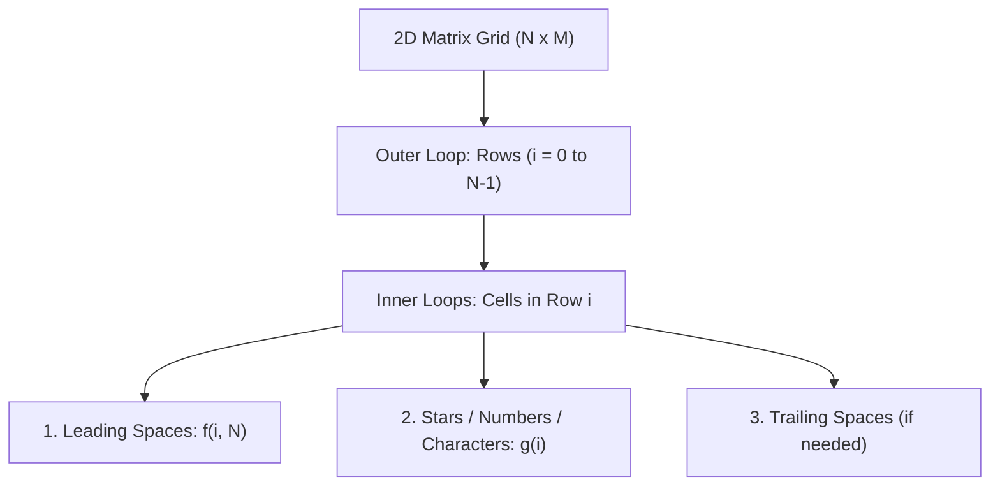
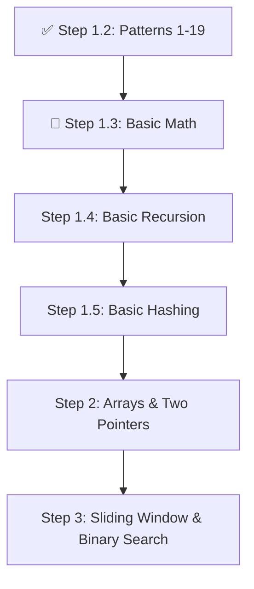

# 🧩 DSA Mastery Roadmap & Pattern Mental Models

**Tags:** #dsa #patterns #algorithms #java #mental-models

---

## 1. The Core Philosophy of Pattern Solving

Pattern printing questions are not about memorizing loops; they are **matrix coordinate geometry** problems. Every pattern question teaches you:
1. Identifying the loop invariants (How does Row `i` relate to Column `j`?).
2. Mapping discrete mathematical sequences ($2i - 1$, $2(N - i - 1)$, etc.).
3. Handling symmetry (Mirroring via midpoint splits or distance functions).

---

## 2. Taxonomy of Patterns (Patterns 1 to 19 Mastered)

All 19 patterns solved in `knowledge-vault/01-DSA/01-basics/02-patterns/` fall into 4 core mathematical families:

### Family A: Direct Monotonic Triangles (Patterns 1–6)
- **Increasing Right-Angled:** Stars count equals row index `j <= i`.
- **Inverted Right-Angled:** Stars count decreases with row: `j < N - i`.
- **Numeric Variation:** Replace `*` with `j + 1` (column-based) or `i + 1` (row-based).

### Family B: Pyramids & Diamond Symmetry (Patterns 7–10)
- **The Pyramid Invariant:**
  - Leading spaces: $N - i - 1$
  - Stars: $2i + 1$ (always odd: $1, 3, 5, 7...$)
- **The Diamond (Pattern 9):**
  - Top half: Standard pyramid ($i = 0 \dots N-1$).
  - Bottom half: Inverted pyramid with spaces $i$ and stars $2(N - i) - 1$.
- **The Half Diamond (Pattern 10):**
  - Number of stars at row $i$ for $2N-1$ rows: $\text{stars} = i \le N ? i : 2N - i$.

### Family C: Binary Alternation & Number Crowns (Patterns 11–13)
- **Alternating Bits (Pattern 11):**
  - If row starts with `1` when `i % 2 == 0`, every toggle is `val = 1 - val` or $(i + j) \% 2 == 0 \to 1 \text{ else } 0$.
- **Number Crown (Pattern 12):**
  - Symmetrical numbers with dynamic center gap:
    - Left numbers: `1` to `i`
    - Spaces: $2 \times (N - i)$
    - Right numbers: `i` down to `1`
- **Floyd's Triangle (Pattern 13):**
  - Running continuous counter `int count = 1;` across all cells.

### Family D: Character & Hollow Symmetry (Patterns 14–19)
- **Character Grids (Patterns 14–18):**
  - Mapping loop index to ASCII: `(char)('A' + j)`.
  - Palindromic letter pyramid (Pattern 17): Increment letters up to midpoint, then decrement!
- **Hollow Symmetrical Butterfly & Diamond (Pattern 19):**
  - Composed of two mirror symmetric halves.
  - Inverted hollow diamond: Left stars $N - i$, center spaces $2i$, right stars $N - i$.
  - Bottom inverted: Left stars $i + 1$, center spaces $2(N - i - 1)$, right stars $i + 1$.

---

## 3. The Next DSA Milestones

### Next Immediate Sprints:
1. **Basic Math Invariants:**
   - Digit extraction (`n % 10`, `n / 10`)
   - Reverse a 32-bit Integer (handling overflow: `Integer.MAX_VALUE / 10`)
   - Palindrome Number test without string conversion
   - Euclidean Algorithm for Greatest Common Divisor ($\gcd(a, b) = \gcd(b, a \pmod b)$) in $\mathcal{O}(\log(\min(a, b)))$
2. **Array Foundations:**
   - Two Pointers (Dutch National Flag, 2Sum, 3Sum)
   - Sliding Window (Maximum Subarray / Kadane's Algorithm)
