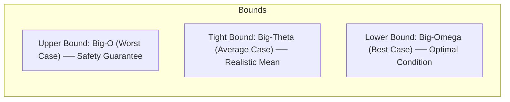

<div align="center">

# ⏱️ Striver A2Z DSA • Step 1.3: Time & Space Complexity
### *The Definitive Algorithmic Complexity, Asymptotic Analysis & Resource Blueprint*

[](https://takeuforward.org/prep-hub/strivers-a2z-dsa-sheet)
[](https://www.youtube.com/watch?v=FPu9Uld7W-E)
[](https://www.oracle.com/java/)
[](https://obsidian.md)
[-10B981?style=for-the-badge&logo=target&logoColor=white)](#)

<p align="center">
  <b>Time complexity is NOT about counting seconds on a stopwatch.</b><br>
  It is the mathematical rate at which execution time and memory scale as input size $N$ approaches infinity.<br>
  Based on <b>Striver's A2Z DSA Lecture (takeUforward)</b>, adapted for <b>AI-bou</b> second brain engineering.
</p>

---

[⚡ Master Mental Models](../../00-DSA-Roadmap-and-Mental-Models.md) • [📐 Pattern Code Matrix](../02-patterns/README.md) • [💻 Java Verification Suite](./TimeComplexityDemo.java) • [🏠 Root DetaKozo](../../README.md)

---

</div>

## 📌 Table of Contents
1. [The Fundamental Fallacy: Why Seconds ≠ Time Complexity](#1-the-fundamental-fallacy-why-seconds--time-complexity)
2. [What is Time Complexity? (The Rate of Increase)](#2-what-is-time-complexity-the-rate-of-increase)
3. [The Asymptotic Trinity: Big-O, Big-Omega & Big-Theta](#3-the-asymptotic-trinity-big-o-big-omega--big-theta)
4. [Striver's 3 Golden Rules for Big-O Computation](#4-strivers-3-golden-rules-for-big-o-computation)
5. [Step-by-Step Code Analysis & Loop Taxonomy](#5-step-by-step-code-analysis--loop-taxonomy)
   - [Pattern 1: Single Linear Loop $O(N)$](#pattern-1-single-linear-loop-on)
   - [Pattern 2: Sequential Independent Loops $O(N + M)$](#pattern-2-sequential-independent-loops-on--m)
   - [Pattern 3: Nested Independent Loops $O(N^2)$](#pattern-3-nested-independent-loops-on2)
   - [Pattern 4: Dependent Triangular Loops $\frac{N(N+1)}{2} \to O(N^2)$](#pattern-4-dependent-triangular-loops-fracnn12-to-on2)
   - [Pattern 5: Step-Jump Loops (Add/Subtract) $O(N)$](#pattern-5-step-jump-loops-addsubtract-on)
   - [Pattern 6: Geometric & Logarithmic Loops (Multiply/Divide) $O(\log N)$](#pattern-6-geometric--logarithmic-loops-multiplydivide-olog-n)
6. [Space Complexity: Auxiliary Space vs. Input Space](#6-space-complexity-auxiliary-space-vs-input-space)
   - [The Strict Engineering Warning on Input Mutation](#the-strict-engineering-warning-on-input-mutation)
7. [The Online Judge $10^8$ Operations Rule & Constraint Decryption](#7-the-online-judge-108-operations-rule--constraint-decryption)
8. [Complexity Growth Comparison Chart & Hierarchy](#8-complexity-growth-comparison-chart--hierarchy)
9. [Interview Self-Defense & Practice Drills](#9-interview-self-defense--practice-drills)

---

## 1. The Fundamental Fallacy: Why Seconds ≠ Time Complexity

When beginners measure code performance, they often do this:

```java
long start = System.currentTimeMillis();
// run algorithm
long end = System.currentTimeMillis();
System.out.println("Execution time: " + (end - start) + " ms");
```

> [!CAUTION]
> **Why Stopwatch Benchmarking Fails:**
> 1. **Machine Disparity**: An algorithm run on an old Intel Core 2 Duo laptop will take 10× longer than on a top-spec Apple M3 Max or Intel Core i9 workstation.
> 2. **OS Scheduling & Background Tasks**: Anti-virus scans, browser tabs, thermal throttling, and garbage collector spikes inject huge random noise.
> 3. **Programming Language Overheads**: Python, Java (JVM warm-up), and C++ execute the exact same instructions at radically different raw speeds.

Therefore, **we cannot measure algorithmic efficiency in wall-clock seconds or milliseconds.**

---

## 2. What is Time Complexity? (The Rate of Increase)

> **Definition**: **Time Complexity** is the mathematical relationship between the size of the input ($N$) and the rate at which the number of elementary operations (and thus execution time) grows.

### The Slope Comparison Mental Model

Imagine executing the exact same linear loop on two vastly different machines:

```
Execution Time
     ▲
     │           / Machine A (Old Budget Laptop, slow clock speed)
     │          /   Slope = m1
     │         /
     │        /       / Machine B (Modern High-End Workstation)
     │       /       /   Slope = m2
     │      /       /
     │     /       /  
     │    /       /   
     │   /       /    
     │  /       /     
     └─/───────/────────────────▶ Input Size (N)
       (Linear Rate of Growth: Both are O(N)!)
```

* **Observation**: Machine A takes more absolute seconds than Machine B for any given $N$.
* **Algorithmic Reality**: Both machines produce **straight lines**. As $N$ doubles ($10 \to 20$), the time doubles on both machines. Their **rate of increase** with respect to $N$ is identical: $\mathcal{O}(N)$.

---

## 3. The Asymptotic Trinity: Big-O, Big-Omega & Big-Theta

Algorithms can behave differently depending on the input arrangement (e.g., searching for an element at the beginning vs. the end of an array).

```
   Performance Bound        Mathematical Notation            Practical DSA Meaning
┌──────────────────────┬───────────────────────────────┬───────────────────────────────────────────┐
│ Worst Case           │  Big-O:        O(f(N))        │ Upper Bound (Algorithm will NEVER exceed) │
│ Best Case            │  Big-Omega:    Ω(f(N))        │ Lower Bound (Algorithm will at least take)│
│ Average Case         │  Big-Theta:    Θ(f(N))        │ Tight Bound (Expected / Mean performance) │
└──────────────────────┴───────────────────────────────┴───────────────────────────────────────────┘
```

### Visualizing Asymptotic Curves


### Concrete Example: Conditional Grading / Linear Search
```java
// Marks grading example from Striver's lecture:
if (marks < 25) {
    System.out.println("F");        // 1 check -> Best Case: Ω(1)
} else if (marks <= 44) {
    System.out.println("E");        // 2 checks
} else if (marks <= 49) {
    System.out.println("D");        // 3 checks
} else {
    System.out.println("A");        // 4 checks -> Worst Case: O(1)
}
```

> [!IMPORTANT]
> **Why do Tech Interviews & Online Judges focus almost exclusively on Big-O?**
> System architects and interviewers want **guarantees**. If a company deploys your algorithm into production handling millions of financial transactions, they must know the **worst possible delay** to prevent server crashes, timeouts, and SLA breaches.

---

## 4. Striver's 3 Golden Rules for Big-O Computation

To calculate Big-O without getting bogged down in low-level CPU cycles, apply Striver's 3 inviolable principles:

```
┌────────────────────────────────────────────────────────────────────────┐
│  RULE 1: ALWAYS COMPUTE FOR THE WORST CASE SCENARIO                    │
│          Assume inputs are arranged in the least favorable structure.  │
├────────────────────────────────────────────────────────────────────────┤
│  RULE 2: AVOID / DROP CONSTANTS                                        │
│          Multipliers & constant additions become irrelevant at scale.  │
│          O(3N) ──▶ O(N)       |   O(5N^2 + 100) ──▶ O(N^2)             │
├────────────────────────────────────────────────────────────────────────┤
│  RULE 3: AVOID / DROP LOWER-ORDER TERMS                                │
│          Only keep the highest power / asymptotically dominant term.   │
│          O(4N^3 + 3N^2 + 8) ──▶ O(4N^3) ──▶ O(N^3)                     │
└────────────────────────────────────────────────────────────────────────┘
```

### The Mathematical Proof of Dominance

Consider the polynomial expression:
$$f(N) = 4N^3 + 3N^2 + 8$$

Let us evaluate each term when $N$ scales up to realistic interview sizes ($N = 10^5$):

| Term | Value at $N = 10^5$ | Fractional Share of Total Operations |
| :--- | :--- | :--- |
| **$4N^3$** | $4 \times (10^5)^3 = 4 \times 10^{15} = 4,000,000,000,000,000$ | **$99.99925\%$** (Dominates completely) |
| **$3N^2$** | $3 \times (10^5)^2 = 3 \times 10^{10} = 30,000,000,000$ | $0.00075\%$ (Negligible fraction) |
| **$8$** | $8$ operations | $0.0000000000002\%$ (Utterly zero impact) |

* Adding $+8$ to 4 quadrillion operations is like adding 8 drops of water to the Pacific Ocean.
* Hence:
  $$\lim_{N \to \infty} \frac{4N^3 + 3N^2 + 8}{N^3} = 4 \implies \mathcal{O}(N^3)$$

---

## 5. Step-by-Step Code Analysis & Loop Taxonomy

### Pattern 1: Single Linear Loop $O(N)$
```java
for (int i = 0; i < N; i++) {
    System.out.println("AI-bou");
}
```
**Anatomy of elementary CPU operations:**
1. `int i = 0`: Initialization (happens **1 time**)
2. `i < N`: Condition check (happens **$N + 1$ times**, last check terminates)
3. `System.out.println`: Body execution (happens **$N$ times**)
4. `i++`: Increment (happens **$N$ times**)

$$\text{Total Operations} = 1 + (N + 1) + N + N = 3N + 2$$
* Applying Rule 3 (Drop lower-order constant $+2$): $3N$
* Applying Rule 2 (Drop constant factor $3$): $\mathcal{O}(N)$

---

### Pattern 2: Sequential Independent Loops $O(N + M)$
```java
for (int i = 0; i < N; i++) {
    // some O(1) work
}

for (int j = 0; j < M; j++) {
    // some O(1) work
}
```
* Loop 1 takes $O(N)$ operations.
* Loop 2 takes $O(M)$ operations.
* Since they are **sequential** (one after another, not nested), we **add** them:
  $$\text{Time Complexity} = \mathcal{O}(N + M)$$
> [!NOTE]
> If the problem guarantees $N == M$, then $O(N + N) = O(2N) = O(N)$. But if $N$ and $M$ are distinct independent input sizes, you **must keep both**: $\mathcal{O}(N + M)$.

---

### Pattern 3: Nested Independent Loops $O(N^2)$
```java
for (int i = 0; i < N; i++) {
    for (int j = 0; j < N; j++) {
        // O(1) elementary operation
    }
}
```
* For each iteration of outer loop $i$ ($0, 1, 2, \dots, N-1$):
  - The inner loop $j$ runs **$N$ full times**.
* Total operations = $N \times N = N^2$
  $$\text{Time Complexity} = \mathcal{O}(N^2)$$
* If the outer loop runs $N$ times and the inner loop runs $M$ times:
  $$\text{Time Complexity} = \mathcal{O}(N \times M)$$

---

### Pattern 4: Dependent Triangular Loops $\frac{N(N+1)}{2} \to O(N^2)$

This is the exact pattern seen throughout our **Pattern Masteries (Patterns 1 to 22)**:

```java
for (int i = 0; i < N; i++) {
    for (int j = 0; j <= i; j++) {
        // inner work
    }
}
```

Let's trace how many times the inner loop executes row-by-row:
- When $i = 0$: inner loop runs for $j = 0$ $\implies$ **1 time**
- When $i = 1$: inner loop runs for $j = 0, 1$ $\implies$ **2 times**
- When $i = 2$: inner loop runs for $j = 0, 1, 2$ $\implies$ **3 times**
- $\dots$
- When $i = N - 1$: inner loop runs for $j = 0, \dots, N-1$ $\implies$ **$N$ times**

$$\text{Total Iterations} = 1 + 2 + 3 + 4 + \dots + N = \sum_{k=1}^N k = \frac{N(N + 1)}{2} = \frac{N^2}{2} + \frac{N}{2}$$

Applying our golden rules:
1. Drop lower order term $\frac{N}{2}$: Leaves $\frac{N^2}{2}$
2. Drop constant coefficient $\frac{1}{2}$: Leaves $N^2$
$$\text{Time Complexity} = \mathcal{O}(N^2)$$

---

### Pattern 5: Step-Jump Loops (Add/Subtract) $O(N)$
```java
for (int i = 0; i < N; i += 2) {
    // work
}
```
* Loop increments by 2 each step: runs $\frac{N}{2}$ times.
* Dropping constant coefficient $\frac{1}{2}$:
  $$\text{Time Complexity} = \mathcal{O}(N)$$

---

### Pattern 6: Geometric & Logarithmic Loops (Multiply/Divide) $O(\log N)$
```java
for (int i = 1; i <= N; i *= 2) {
    // work
}
```
Let us trace the values taken by loop variable $i$:
$$i = 1, 2, 4, 8, 16, 32, \dots, 2^k$$

The loop terminates when:
$$2^k > N$$
$$2^k = N \implies k = \log_2(N)$$

$$\text{Time Complexity} = \mathcal{O}(\log_2 N)$$

> [!TIP]
> **Rule of Thumb for Logarithmic Complexity**:
> Whenever an algorithm repeatedly **divides the search space by half** (like Binary Search) or multiplies its counter exponentially by a factor ($2, 3, k$), the number of steps is logarithmic: $\mathcal{O}(\log N)$.

---

## 6. Space Complexity: Auxiliary Space vs. Input Space

> **Definition**: **Space Complexity** is the total memory space required by an algorithm to execute to completion, expressed as a function of input size $N$.

$$\mathbf{Total\ Space\ Complexity} = \mathbf{Input\ Space} + \mathbf{Auxiliary\ Space}$$

```
┌────────────────────────────────────────────────────────────────────────┐
│ 1. INPUT SPACE: Memory required to store the inputs given to code      │
│    (e.g., An array int[] arr of size N passed as argument)             │
├────────────────────────────────────────────────────────────────────────┤
│ 2. AUXILIARY SPACE: Extra / temporary memory allocated by the algorithm │
│    to solve the problem (temporary arrays, hash maps, recursion stack) │
└────────────────────────────────────────────────────────────────────────┘
```

### Example: Sum of Two Numbers
```java
int a = 10;
int b = 20;
int c = a + b;
```
* **Input Space**: Variables `a` and `b` ($2 \times 4$ bytes = constant space $O(1)$)
* **Auxiliary Space**: Extra variable `c` ($1 \times 4$ bytes = constant space $O(1)$)
* **Total Space Complexity**: $\mathcal{O}(1)$

### Example: Array Reversal
```java
// Method 1: Using Auxiliary Array
int[] reverseArray(int[] arr, int n) {
    int[] temp = new int[n]; // Auxiliary space: O(N)
    for (int i = 0; i < n; i++) {
        temp[i] = arr[n - 1 - i];
    }
    return temp;
}
// Input Space: O(N), Auxiliary Space: O(N), Total Space: O(N)

// Method 2: In-place Two Pointers
void reverseInPlace(int[] arr, int n) {
    int left = 0, right = n - 1; // Auxiliary space: O(1)
    while (left < right) {
        int t = arr[left];
        arr[left] = arr[right];
        arr[right] = t;
        left++;
        right--;
    }
}
// Input Space: O(N), Auxiliary Space: O(1), Total Space: O(N)
```

---

### The Strict Engineering Warning on Input Mutation

In his lecture, Striver emphasizes an indispensable industry standard:

> [!WARNING]
> ### 🛑 Striver's Golden Warning: Never Mutate Input Data Blindly!
> In interview discussions, candidates often proudly say:
> *"Look, I mutated the original input array in-place, so my extra space is $O(1)$!"*
> 
> **Why this can cost you an offer in senior software engineering interviews:**
> 1. In real-world enterprise architectures, the input data array is passed by **reference**.
> 2. Mutating that array directly modifies the shared memory state. Other microservices, background threads, or caller functions relying on that original data will suffer **data corruption or concurrency race conditions**.
> 3. **The Professional Protocol**: Always ask the interviewer:
>    - *"Am I allowed to mutate the original input array in-place, or should I preserve data integrity and use $O(N)$ auxiliary space?"*

---

## 7. The Online Judge $10^8$ Operations Rule & Constraint Decryption

In coding interviews and competitive programming (LeetCode, Codeforces, CodeChef), your solution is executed on remote judging servers with strict CPU limits.

```
┌────────────────────────────────────────────────────────────────────────┐
│                       THE 1-SECOND BENCHMARK                           │
│     Modern Online Judges can perform roughly ~ 10^8 operations/sec      │
└────────────────────────────────────────────────────────────────────────┘
```

If your code executes more than $\approx 10^8$ operations within the 1-second limit, the platform aborts your process with:
$$\mathbf{TLE \quad (Time \quad Limit \quad Exceeded)}$$

### 🔑 The Constraint-to-Complexity Decryption Cheat Sheet

Before writing a single line of code, **read the constraints on $N$**. The problem setter is explicitly giving away the expected algorithm!

| Input Constraint ($N$) | Maximum Allowed Complexity | Feasible Algorithmic Paradigms |
| :--- | :--- | :--- |
| **$N \le 10 \dots 11$** | $\mathcal{O}(N!)$ or $\mathcal{O}(2^N \times N)$ | Pure Brute Force, Permutations, Recursion |
| **$N \le 20 \dots 25$** | $\mathcal{O}(2^N)$ | Backtracking, Bitmask DP, Subsets generation |
| **$N \le 100$** | $\mathcal{O}(N^4)$ | 4-nested loops, brute-force quad-check |
| **$N \le 500$** | $\mathcal{O}(N^3)$ | 3-nested loops, Floyd-Warshall, Matrix Multiplications |
| **$N \le 10^3$ ($1,000$)** | $\mathcal{O}(N^2)$ | Two nested loops, Bubble/Insertion Sort, 2D Grid DP |
| **$N \le 10^5 \dots 10^6$** | $\mathcal{O}(N \log N)$ or $\mathcal{O}(N)$ | Merge Sort, Binary Search, Two Pointers, Sliding Window, HashMaps |
| **$N \le 10^8$** | $\mathcal{O}(N)$ or $\mathcal{O}(\log N)$ | Single linear scan, Simple mathematical formula |
| **$N \ge 10^9 \dots 10^{18}$** | $\mathcal{O}(\log N)$ or $\mathcal{O}(1)$ | Binary Search on Answer, Matrix Exponentiation, Direct Math / GCD |

### 💡 Example of Reading Constraints:
* Suppose a LeetCode problem says: **$N \le 10^5$**.
* If you design an $O(N^2)$ brute-force solution:
  $$\text{Operations} = (10^5)^2 = 10^{10}$$
* Since $10^{10} \gg 10^8$, it will take $\approx 100$ seconds $\implies$ **Guaranteed TLE!**
* The constraints tell you that you **must** optimize down to $\mathcal{O}(N \log N)$ or $\mathcal{O}(N)$.

---

## 8. Complexity Growth Comparison Chart & Hierarchy

From lightning fast to computational death:

$$\mathcal{O}(1) < \mathcal{O}(\log N) < \mathcal{O}(\sqrt{N}) < \mathcal{O}(N) < \mathcal{O}(N \log N) < \mathcal{O}(N^2) < \mathcal{O}(N^3) < \mathcal{O}(2^N) < \mathcal{O}(N!)$$

```
Operations (f(N))
     ▲
     │                                      / O(N!)
     │                                     /
     │                                    /  / O(2^N)
     │                                   /  /
     │                                  /  /  / O(N^2)
     │                                 /  /  /
     │                                /  /  /  / O(N log N)
     │                               /  /  /  /
     │                              /  /  /  /  / O(N)
     │                             /  /  /  /  /
     │                            /  /  /  /  /   / O(log N)
     │                           /  /  /  /  /   /
     │  ─────────────────────────────────────────── O(1) Constant
     └─────────────────────────────────────────────────────────────▶ Input (N)
```

---

## 9. Interview Self-Defense & Practice Drills

### 🧪 Quick Self-Check Questions

1. **Question**: An algorithm has two nested loops: outer runs $N$ times, inner loop runs $\log_2 N$ times. What is the time complexity?
   - **Answer**: $\mathcal{O}(N \log N)$. The inner loop executes $\log N$ times for each of the $N$ outer iterations.

2. **Question**: You have code with $T(N) = 100N^2 + 5000N + 2^{30}$. What is its Big-O complexity?
   - **Answer**: $\mathcal{O}(N^2)$. Drop constant multipliers ($100$), drop lower-order terms ($5000N$), and drop constants ($2^{30}$ is huge, but it's independent of $N$).

3. **Question**: Can an algorithm with $\mathcal{O}(N^2)$ run faster than an algorithm with $\mathcal{O}(N)$?
   - **Answer**: **Yes, for tiny values of $N$!** If Algorithm 1 is $1000N$ and Algorithm 2 is $N^2$, for $N = 5$:
     - Alg 1: $1000(5) = 5000$ ops.
     - Alg 2: $5^2 = 25$ ops.
     - For small $N$, $N^2$ wins. But as $N \to \infty$, Big-O describes the asymptotic rate where $\mathcal{O}(N)$ permanently outclasses $\mathcal{O}(N^2)$.

---

## 💻 Standalone Verification Suite
To physically inspect how operations scale versus wall-clock nanoseconds in Java 21, compile and run the companion test runner:

```bash
javac 01-basics/03-time-complexity/TimeComplexityDemo.java
java -cp 01-basics/03-time-complexity TimeComplexityDemo
```
